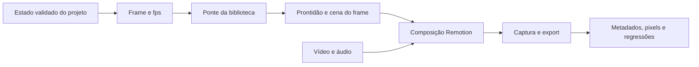

# Capacidades integradas e como escolher uma ponte

Este catálogo reúne os mecanismos implementados no protótipo após o estudo sequencial. A revisão da fonte, o código seguido, a decisão e as limitações ficam no estudo de cada linha. Consulte [FILA.md](FILA.md) para os checkpoints GitHub e [FONTES.md](FONTES.md) para a proveniência. Não equivale a uma auditoria integral dos repositórios ou a uma IA de edição completa.

## Escolha pelo problema

| Necessidade no editor | Integração executável | Modelo de avaliação | Atenção ao adaptar |
| --- | --- | --- | --- |
| Cortes, vídeo, áudio e export | [Remotion](remotion/README.md), `CodexStudy` | Frame/fps + estado de projeto validado | O contrato atual tem uma faixa de vídeo contígua e uma cama de áudio; não é uma timeline multifaixa geral. |
| Easing, stagger e timeline numérica | [Anime.js](animejs/README.md), `AnimeMotionStudy` | Timeline nova pausada por amostra | Reutilizar a timeline falhou ao voltar do fim; o adapter evita essa dependência. |
| Efeitos de formas e partículas | [mo.js](mojs/README.md), `MojsStudy` | Progresso normalizado absoluto | Aplicar zero antes do progresso pedido; sem isso a primeira integração ficou estática. |
| Keyframes persistidos | [Theatre](theatre/README.md), `TheatreStudy` | Estado JSON + sequência posicionada + driver explícito | Formato da fonte e runtime publicado diferem. Só core foi integrado; Studio tem licença distinta. |
| Cena vetorial e grupos | [Two.js](two/README.md), `TwoStudy` | Propriedades absolutas + um update SVG | O npm fixado não possui o dispose visto no HEAD. Cleanup usa APIs disponíveis; limite de métricas de texto está registrado. |
| Gráficos por dados | [D3](d3/README.md), `D3Study` | Escalas, join por ID, interpolação e easing | Evitar d3-transition/timers no export; validar IDs/valores e manter dados imutáveis. |
| Shader com iluminação | [Custom Shader Material](custom-shader-material/README.md), `CustomShaderMaterialStudy` | Uniform de tempo absoluto + normais analíticas + render | Chunks dependem do Three; bounds CPU, sombras e WebGPU exigem validações próprias. |
| Cena 3D procedural | [Three](three/README.md), `ThreeStudy` | Transformações absolutas + render único | Geometria/material/renderer/contexto precisam de descarte; câmera/aspect e cor fazem parte do contrato. |
| Keyframes nativos de uma engine | [Babylon](babylon/README.md), `BabylonStudy` | AnimationGroup iniciado/pausado + goToFrame | Ignorar avanço automático no render. Física, blending e eventos não estão validados por esse ensaio. |
| Helpers declarativos 3D | [Drei](drei/README.md), `DreiStudy` | R3F sem loop, efeitos de layout, advance explícito | Alguns helpers usam aleatoriedade/tempo ou loaders. RoundedBox/Center foram verificados, não o catálogo inteiro. |
| Fluido por partículas | [SPlisHSPlasH](splishsplash/README.md), `SplishsplashStudy` | DFSPH C++ nativo → snapshots → seek | Inicialização 2D e registro de vizinhos exigem ordem correta; espuma/meshing não integrados. |
| Simulação numérica com cache | [Taichi](taichi/README.md), `TaichiStudy` | Solver CPU com subpassos fixos → snapshots → seek | GPU não validada; mudanças da física exigem novo bake. Cache e gerador possuem hashes verificados. |
| Grafo serializado de motion | [Cables](cables/README.md), `CablesStudy` | Portas e links do kernel com tempo externo | O preset incorpora o runtime numérico selecionado; interface desktop, CGL e patches arbitrários não estão integrados. |
| Representação por Gaussian splats | [Spark](spark/README.md), `SparkStudy` | Dados locais + transformação + update/sort aguardado | Readiness envolve workers/WASM/GPU. Streaming e LoD precisam de protocolo adicional; getSplat retorna scratch reutilizado. |

Cada linha é um preset separado. Não há conversão automática de objetos Three para Babylon nem um formato universal de keyframes entre Theatre, Anime e Babylon. Preservar fronteiras permite escolher o mecanismo conforme a capacidade desejada.

## Estrutura reutilizável

`BrowserStudy` isola o host de cada frame e integra delayRender/cleanup. O contrato não elimina responsabilidades da biblioteca: cada ponte deve aguardar seus próprios recursos e liberar seus próprios objetos. O runner de estudos conserva o backend de cada composição ao comparar hashes e marca baselines ausentes como não executados.

O catálogo executável está em `demos/remotion-codex/scripts/studies.json`; as composições estão em `src/Root.tsx`. As fábricas numéricas/cenas e os testes ficam ao lado das pontes. [AMBIENTE.md](AMBIENTE.md) descreve instalação, Studio e exports. O Codex pode navegar por esses documentos e executar os comandos; os arquivos não treinam os pesos de um modelo.

## Evidências e limites de comparação

Todos os presets usam 640×360 e 30 fps; os oito estudos têm 90 frames cada. Exportações verificam H.264/AAC, duração, movimento em uma região sem contador e repetição depois de visitar o fim. O último estudo também compara um frame das nove composições anteriores, quando os baselines existem. Isso não equivale a reexportar todas as composições em toda mudança nem garante identidade entre drivers.

Os estudos registram separadamente testes do nosso projeto, subconjuntos oficiais e suítes não executadas. Há falhas/limites upstream em Anime e Two, e instalação upstream recusada no D3. Nenhum desses resultados foi convertido em aprovação fictícia. Os relatórios históricos conservam a contagem da etapa; a suíte local final tem 32 casos. A existência do workflow GitHub Actions não prova execução remota aprovada.

Para distribuição comercial, consultar as licenças fixadas em cada estudo: mo.js/Two/Three/Drei/Spark usam MIT, D3 ISC e Babylon Apache-2.0. Theatre core é Apache-2.0 e Studio AGPL-3.0; este último não foi incorporado. Remotion tem condições próprias detalhadas no estudo. Dependências e assets também podem ter avisos próprios; a licença do repositório principal não cobre automaticamente todo arquivo externo.

## Próximo desenvolvimento, ainda não implementado

O passo mais útil é um **contrato de camadas e operações de edição**, antes de incorporar mais bibliotecas:

1. Definir estado versionado de projeto com camadas, assets e referências a presets, incluindo validação de tempo, dimensões e parâmetros.
2. Representar alterações como operações pequenas: adicionar camada, mudar parâmetro, inserir keyframe, recortar clipe e automatizar volume; aplicar/desfazer com histórico explícito.
3. Fazer um planejador de linguagem natural produzir essas operações; validar e apresentar preview antes de exportar. Nenhum modelo ou planejador já está conectado.
4. Verificar uma edição composta real com vídeo, voz/música e motion sincronizado; medir preview, export e memória com critérios definidos.
5. Só então avaliar reuso de contextos, recuperação semântica do acervo, dados reais, streaming de splats e formato de autoria interoperável.

Essa sequência é uma proposta derivada dos mecanismos e limites observados, não uma alegação de recursos entregues. O lote atual fornece o acervo verificável, as pontes executáveis e as receitas para esse próximo trabalho.
