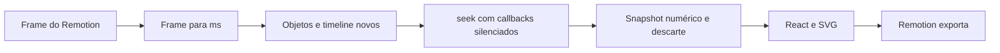

# Integração Anime.js → Remotion → Codex

## Divisão de responsabilidades adotada

| Componente | Responsabilidade no protótipo |
| --- | --- |
| Codex | Ler o projeto, editar código/dados, executar comandos e interpretar relatórios |
| Anime.js | Calcular valores de motion em targets numéricos privados |
| React | Aplicar os valores à estrutura visual da composição |
| Remotion | Escolher frame, compor cena/mídia e renderizar |
| FFprobe/FFmpeg | Inspecionar o arquivo exportado e a região animada |

Anime.js não foi usado como editor audiovisual nem como encoder. A biblioteca não fornece, neste desenho, entendimento de pedidos ou escolha automática de cortes.

## Ponte implementada

Arquivo: `demos/remotion-codex/src/anime-motion.ts`.

1. Validar frame inteiro e fps positivo/finito.
2. Converter para milissegundos. Frames negativos de pré-roll são limitados ao estado inicial neste contrato.
3. Confirmar unidade global `ms` sem modificá-la.
4. Criar objetos e timeline novos para o tempo solicitado, com `autoplay: false`.
5. Definir valores de origem/destino explícitos e posições temporais conhecidas.
6. Executar `seek(tempo, true)` para silenciar callbacks da timeline.
7. Copiar os valores numéricos e cancelar a instância.
8. Usar o snapshot no JSX da composição.



O cálculo não depende de o navegador ter reproduzido os quadros anteriores. Foi validado no desenho selecionado, inclusive visitando todos os 120 frames em ordem embaralhada. Isso não é uma garantia universal para callbacks arbitrários ou outros helpers da biblioteca.

## Por que a timeline é reconstruída

Uma versão inicial reutilizava a instância. A sequência de frames `0, 37, 74, 111, 28` produziu no frame 28 `opacity=0, y=-16`, enquanto uma instância nova produziu `opacity=1, y=0`. O título ficou preso no estado de saída ao voltar de 3,7 s para aproximadamente 0,933 s.

O problema foi reproduzido com apenas dois tweens no mesmo objeto, preservado em [um registro independente](resultados/seek-reuse-reproduction.json). Não foi feito patch no upstream nem afrouxada a comparação. O adaptador passou a avaliar cada amostra com estado novo.

O custo de reconstrução é uma consequência dessa decisão. Ainda não existe benchmark que justifique esse método para milhares de targets por frame. Para animações pequenas ele é uma prova funcional; produção requer medição.

## Como operar pelo Codex

No diretório `demos/remotion-codex`:

```bash
npm ci --no-audit --no-fund
npm run assets
npm run typecheck
npm test
REMOTION_BROWSER_EXECUTABLE=/usr/bin/chromium npm run render:anime
```

`npm test` agora inclui o contrato audiovisual original e os testes do adaptador. O render usa a composição `AnimeMotionStudy`, e a saída fica em `out/anime/` para preservar o experimento original.

O Studio iniciado com `npm run studio` também descobre a nova composição. O comando de smoke existente continua voltado à composição original; não deve ser interpretado como teste completo da nova cena.

## O que foi integrado

- Timeline com labels de entrada e saída.
- Animação de opacidade e posição do título.
- Stagger central de sete barras.
- Progresso numérico de desenho de uma linha SVG.
- Relógio dirigido pelo frame do Remotion e export com duas tarefas de render em paralelo.
- Teste de retorno ao mesmo frame após visitar o fim.
- Verificação de alteração de pixels na região do título do vídeo.

Não foram integrados interação de scroll, WAAPI, escrita direta no DOM, splitText, morphTo, áudio por Anime.js ou geração de movimentos a partir de pedidos livres.

## Licença

O Anime.js estudado é MIT, conforme `LICENSE.md`. O código do motor não foi copiado para o projeto; a dependência publicada mantém seus avisos e condições. A adoção do Anime.js não altera a licença própria do Remotion, já documentada em seu estudo.
