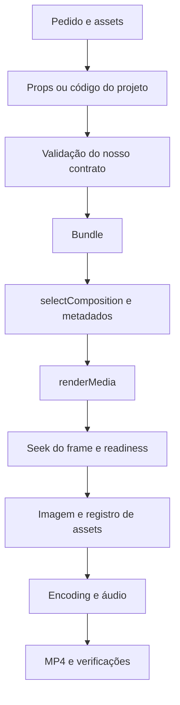

# Arquitetura: do projeto ao arquivo final

Todas as referências abaixo usam o commit indicado no [índice](README.md). Esta é uma reconstrução de mecanismos inspecionados, não uma descrição de cada pacote do monorepo.

## 1. A unidade fundamental é a composição

Um arquivo de entrada chama `registerRoot()` com o componente raiz do projeto. A implementação guarda uma raiz e rejeita registro duplicado. A raiz declara uma ou mais `<Composition>` com identificador, componente, duração em frames, fps e dimensões, ou usa `calculateMetadata()` para resolver metadados.

**Evidência:** `packages/core/src/register-root.ts`, `registerRoot`; `packages/core/src/Composition.tsx`, `CompositionProps` e `CalculateMetadataFunction`.

Composição não é sinônimo de arquivo de mídia. Ela descreve como produzir uma imagem em um instante e quais recursos audiovisuais participam do resultado.

**Aplicação:** a IA pode editar propriedades de uma composição ou seu código. Para mudanças repetitivas, um contrato de dados é uma alternativa mais controlável que gerar JSX novo para cada pedido.

## 2. Tempo é entrada de cálculo

`useCurrentFrame()` lê a posição da timeline, desconta o deslocamento herdado de sequências e aplica a velocidade do contexto. `useVideoConfig()` fornece a configuração da composição. Interpolação e springs transformam esse tempo em valores de estilo e outros parâmetros.

**Evidência:** `packages/core/src/use-current-frame.ts`; `packages/core/src/Sequence.tsx`; `packages/core/src/interpolate.ts`; `packages/core/src/spring/index.ts`.

Isso permite avaliar um frame sem reproduzir todos os anteriores. É uma propriedade essencial para seek e render em paralelo, mas não transforma código arbitrário em código determinístico: relógio externo, estado acumulado e recursos mutáveis ainda podem gerar divergências.

**Aplicação:** preferir animação derivada de frame e props; evitar depender de `setInterval`, de tempo real ou de contadores que só avançam durante playback.

## 3. Preview e exportação compartilham a cena, mas têm caminhos diferentes

O `Player` dirige reprodução e sincronização no navegador. No caminho de `<OffthreadVideo>`, a implementação escolhe entre vídeo para preview e uma implementação específica para exportação. Nesta última, calcula o instante da mídia, solicita um frame ao servidor e o apresenta como imagem.

**Evidência:** `packages/player/src/use-playback.ts`; `packages/core/src/video/OffthreadVideo.tsx`, `InnerOffthreadVideo`; `packages/core/src/video/OffthreadVideoForRendering.tsx`.

Uma preview fluida não demonstra que um export está correto. Também não se deve presumir paridade de todos os codecs e efeitos entre navegador, render no servidor e render no cliente.

**Aplicação:** validar frames exportados, não apenas a presença do Player. O protótipo desta etapa usa o caminho off-thread em exportação; não valida `@remotion/web-renderer`.

## 4. O bundle prepara o projeto para avaliação no navegador

`bundle()` prepara uma entrada de renderização, resolve o componente do usuário e configura o compilador. Nesta revisão, o código inclui caminhos de Webpack e Rspack. Também gerencia a localização de recursos públicos e o diretório de saída.

**Evidência:** `packages/bundler/src/bundle.ts`, `getConfig` e `bundle`.

O bundle é uma unidade reaproveitável para renders com parâmetros diferentes quando os recursos e as condições de execução correspondem ao mesmo projeto. Não é necessário recompilar o monorepo inteiro para usar os pacotes publicados.

## 5. A seleção resolve a composição e seus metadados

`selectComposition()` avalia a raiz no bundle e resolve a composição escolhida, incluindo `calculateMetadata()`. Props usadas nessa etapa devem ser as mesmas do render; caso contrário, é possível selecionar uma duração para um conjunto de dados e desenhar outro.

**Evidência:** `packages/renderer/src/select-composition.ts`; exemplo em `packages/docs/docs/ssr-node.mdx`.

**Aplicação:** gerar um job com identidade da composição, props, revisão do projeto e opções de export. O script do protótipo reutiliza as mesmas props na seleção e no render e grava o hash do arquivo de configuração.

Um ensaio detectou o limite na prática: passar um novo título a `renderStill()` com a composição anteriormente selecionada manteve a imagem original. `render-still.ts` serializa `composition.props` como props resolvidas. O fluxo foi corrigido para selecionar uma composição para a variante antes de renderizá-la. O resultado desse ensaio é um erro de uso corrigido no protótipo, não um defeito confirmado do Remotion.

## 6. Um frame passa por seek, readiness, captura e coleta de recursos

O renderizador solicita um frame à página com `window.remotion_setFrame()`. Depois aguarda o estado `remotion_renderReady`, trata cancelamento/timeouts e espera o carregamento das fontes. O caminho de render do frame captura a imagem e coleta os assets registrados no contexto da página.

**Evidência:** `packages/renderer/src/seek-to-frame.ts`, `seekToFrame` e `waitForReady`; `packages/renderer/src/render-frame-with-option-to-reject.ts`; `packages/renderer/src/collect-assets.ts`.

`delayRender()` e `continueRender()` fazem parte desse acordo de readiness. Um handle não liberado pode interromper a renderização; aumentar timeout sem investigar o recurso pendente não resolve a causa.

**Aplicação:** identificar recursos assíncronos, manter assets/fontes disponíveis e registrar erros por frame. Não confundir carregamento incompleto com defeito visual do layout.

## 7. Áudio não é capturado do som emitido pelo navegador

No caminho de áudio HTML5 inspecionado, o componente registra fonte, frame global, frame da mídia, volume e velocidade no gerenciador de assets. O renderizador coleta esses dados durante a avaliação. A orquestração de render passa as informações de assets à etapa que produz o arquivo final.

**Evidência:** `packages/core/src/audio/AudioForRendering.tsx`; `packages/core/src/audio/use-audio-frame.ts`; `packages/renderer/src/collect-assets.ts`; `packages/renderer/src/render-media.ts`.

**Aplicação:** medir o áudio no arquivo exportado. Um `<audio>` funcionando interativamente não comprova mixagem, fades ou alinhamento no resultado final.

## 8. O render coordena frames e encoding

`renderMedia()` valida opções e composições, prepara servidor e recursos, executa `internalRenderFrames()` e coordena a montagem com `internalStitchFramesToVideo()`. Há otimizações, como pré-encoding, que tornam incorreto imaginar que sempre se escreve primeiro uma pasta completa de PNGs.

**Evidência:** `packages/renderer/src/render-media.ts`, `internalRenderMediaRaw`; `packages/renderer/src/stitch-frames-to-video.ts`.

**Aplicação:** usar a API pública para render. Os símbolos internos são referências para entender o mecanismo, não contratos estáveis para nossa integração.

O entendimento do pedido e a validação do nosso contrato são camadas nossas. O diagrama não atribui um interpretador de linguagem natural ao motor do Remotion.

## O que esta arquitetura não resolve automaticamente

Entender intenção; escolher bons cortes; localizar momentos relevantes na fala; compor com qualidade estética; manter histórico de produto; resolver conflitos de edição; organizar direitos de assets; distribuir jobs. Esses problemas podem usar o motor, mas precisam de desenho e validação próprios.
